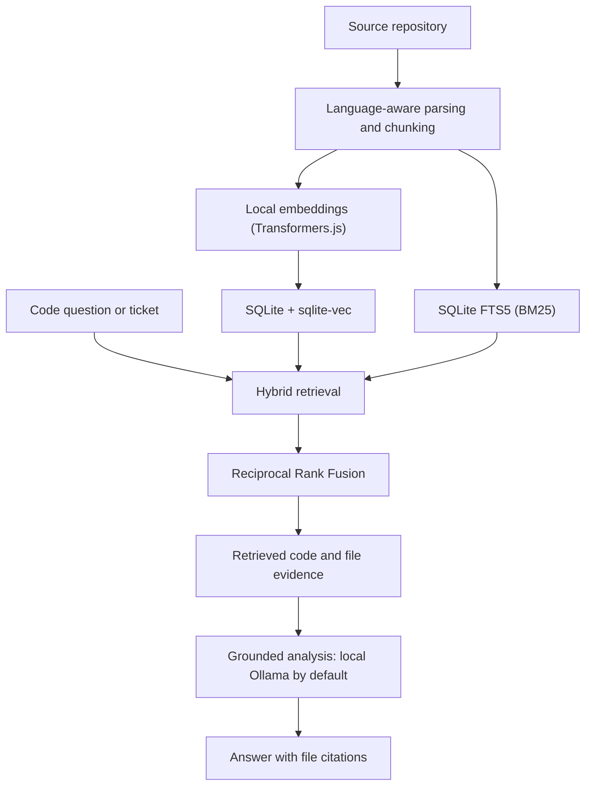
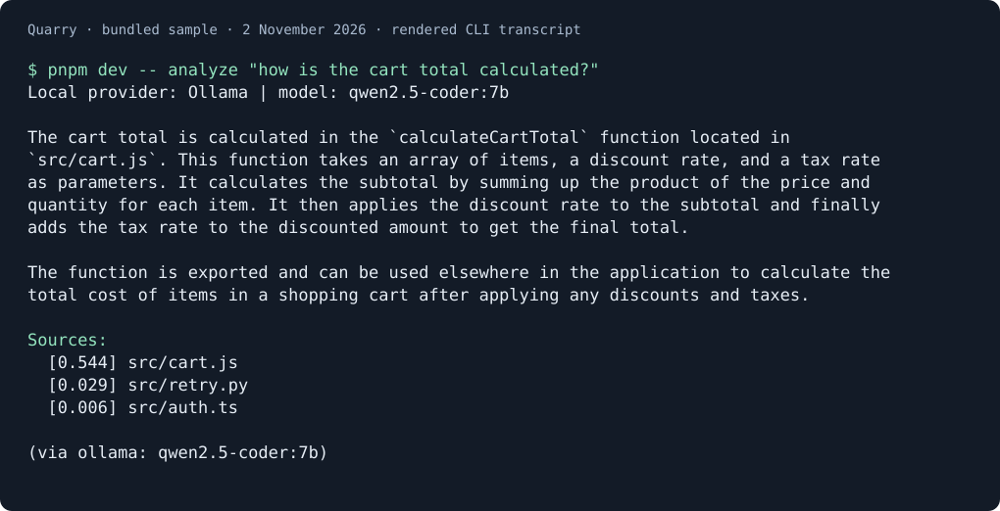

# Quarry

**Find relevant code locally, then ask questions with source-file citations.**

Quarry helps engineers locate code behind a question or ticket without sending source to a hosted embedding service. It indexes a repository locally, combines semantic and keyword search, and passes retrieved code to a local Ollama model instructed to answer from that context and cite its sources.

The default path needs no API key or database server. The embedding model downloads on first use; hosted analysis is optional and explicitly enabled.

Maintained by [Karl Doyle](https://github.com/KarlDoyle). Source: [github.com/KarlDoyle/quarry](https://github.com/KarlDoyle/quarry).

**Status:** Release-ready, as assessed by the maintainer. Evaluation caveats and provider data-handling details below are part of the release context.


## When Quarry is a good fit

- You want semantic and exact-term search over a repository you can process locally.
- You want code questions or ticket analysis with retrieved source files available for inspection.
- You prefer local embeddings, SQLite storage and local model inference.

Quarry is less suitable when you need guaranteed answer correctness, continuously updated indexes or automated code changes. Retrieved context can be incomplete, and generated answers still need review.

## Architecture at a glance



The local-first default keeps indexing and retrieval on the developer's machine. An explicitly selected Anthropic provider or remote Ollama endpoint changes where retrieved context is sent; see [Technical design](#technical-design).

## How it works

1. **Index:** parse and chunk source files using language-aware handling.
2. **Embed:** generate local embeddings with Transformers.js.
3. **Store:** keep vectors, source text and full-text search data in Node's built-in SQLite.
4. **Retrieve:** combine dense vector search and BM25 keyword search using Reciprocal Rank Fusion.
5. **Analyse:** send retrieved context to a local LLM and produce an answer grounded in the source, with file citations.

```text
Repository → chunks → local embeddings + SQLite FTS5
Question → dense search + BM25 → RRF ranking → retrieved context → answer + citations
```

The default analysis provider is local Ollama. Anthropic is available when selected explicitly, or as an explicitly enabled fallback. A configured Anthropic key alone never enables hosted inference.

## Why hybrid retrieval?

Semantic retrieval can find conceptually related code, while keyword retrieval can be useful for exact identifiers, symbols and error strings. Quarry combines both signals rather than relying on either alone.

The bundled evaluation is a small smoke test for the evaluation harness, not
evidence of representative retrieval quality. Use a corpus and gold set you
have permission to process before making performance claims.

### Evaluation

`pnpm eval` runs a three-query retrieval smoke evaluation against the bundled sample repository, comparing hybrid and dense-only search. It does not establish representative retrieval quality or generated-answer correctness.

See [Evaluation](docs/EVALUATION.md) for metric definitions, limitations and a plan for using a permitted corpus and matching gold set. Existing corpus-specific measurements are recorded separately in [eval/RESULTS.md](eval/RESULTS.md).

Run the evaluation with:

```bash
pnpm eval
# Or supply a corpus and a matching JSON gold set:
pnpm eval /path/to/repository /path/to/goldset.json
```

## Ticket analysis

Quarry also exposes an `analyze-ticket` path that can ingest a Jira issue and analyse it against an indexed repository. It retrieves likely relevant code and asks the model to identify an approach, likely affected files and risks.

This capability became the foundation for **Marshal**, a separate MVP workflow that reuses Quarry's retrieval engine for multi-repository routing, CODEOWNERS-based ownership evidence and structured ticket refinement. Separating retrieval from ticket workflow lets each component evolve and be tested independently; Marshal is a technical spike, not a complete Jira product.

## Technical design

- **Runtime:** Node.js 24+, TypeScript.
- **Storage:** Node's built-in `node:sqlite`, `sqlite-vec` and SQLite FTS5.
- **Embeddings:** Transformers.js, running locally.
- **Retrieval:** dense vector search + BM25 keyword search, fused with Reciprocal Rank Fusion.
- **LLM:** local Ollama by default; optional Anthropic provider.
- **Interface:** CLI and importable library surface.

The [architecture note](docs/architecture.md) traces the indexing and answer path. [Retrieval design and decisions](docs/retrieval-design.md) records the existing choices, trade-offs and evidence limits.

No database server or native compiler is required for the native runtime path. The first index run downloads the embedding model from Hugging Face; subsequent indexing and retrieval can run locally. Local Ollama analysis sends prompts to the configured Ollama endpoint (localhost by default). Selecting Anthropic, or enabling hosted fallback, sends the query, ticket details, and retrieved source context to Anthropic. Setting `OLLAMA_HOST` to a remote server also sends that context to the configured server.

## Package installation

The package name is `@mrkarldoyle/quarry`. Install the CLI globally with:

```bash
npm install --global @mrkarldoyle/quarry
```

To use Quarry as a library in a project, install it as a dependency with `npm install @mrkarldoyle/quarry`.

## Quick start

```bash
pnpm install
pnpm build

node dist/cli.js index ./examples/sample-repo
node dist/cli.js search "retry a request with backoff"
node dist/cli.js analyze "how is the cart total calculated?"
node dist/cli.js analyze-ticket --fixture ./tests/fixtures/jira-issue.json
node dist/cli.js stats
```

For `analyze` and `analyze-ticket`, start Ollama and pull a model such as `llama3.1`:

```bash
ollama serve
ollama pull llama3.1
```

Hosted Anthropic use is explicit. Set `QUARRY_PROVIDER=anthropic` and
`ANTHROPIC_API_KEY` to select it, or also set `QUARRY_ANTHROPIC_FALLBACK=true`
to permit fallback if local Ollama fails.

The first indexing run downloads the embedding model once. The default local path does not require an API key.

### Cited-answer demo



Rendered transcript of a real local run on 2 November 2026; startup logs omitted, answer and source list unchanged. The answer describes summing price × quantity, applying the discount, then taxing the discounted amount. Checked against [the sample cart source](examples/sample-repo/src/cart.js). This is illustrative output, not a quality benchmark; scores in the source list are retrieval scores, not answer confidence.

To reproduce with Ollama running and `qwen2.5-coder:7b` available, use a separate demo index and explicit local settings:

```bash
export QUARRY_DATA_DIR=/private/tmp/quarry-portfolio-demo-20261102
export QUARRY_PROVIDER=ollama QUARRY_LLM=ollama
export QUARRY_ANTHROPIC_FALLBACK=false
export QUARRY_MODEL=qwen2.5-coder:7b
export OLLAMA_HOST=http://127.0.0.1:11434
pnpm dev -- index ./examples/sample-repo
pnpm dev -- analyze "how is the cart total calculated?"
```

Generated wording may vary. An earlier run with `llama3.1` retrieved the same source but incorrectly reported insufficient context; see [the evaluation note](docs/EVALUATION.md#verification-on-2-november-2026).

## Engineering approach

The retrieval evaluation records both the cases where hybrid search helps and the cases where dense-only search performs better. AI assistants helped with implementation and test development. I chose the retrieval design, reviewed the results and decided which trade-offs to keep.

## Testing and quality gates

Tests cover local embedding and SQLite retrieval, sample-repository indexing and ticket retrieval, source-position metadata, indexing safeguards, configuration, provider behaviour, ingestion and credential-pattern scanning. Ticket-analysis tests use a mock LLM; provider HTTP tests mock requests.

These checks do not establish real-model answer correctness, citation faithfulness or resistance to prompt injection.

Run the checks locally:

```bash
pnpm check
pnpm lint
pnpm coverage
pnpm build
```

`pnpm test` runs the suite without coverage enforcement. CI runs the checks above in order, then installs the packed package in a clean consumer and checks library exports and CLI help. The pre-push hook runs `pnpm check` and `pnpm test`. See the [workflow runs](https://github.com/KarlDoyle/quarry/actions).

Tests using real embeddings may download the model on first use. Run `pnpm eval` separately for the retrieval smoke evaluation.

## Roadmap

- ✅ Local index → hybrid search → grounded analysis in a local SQLite store.
- ✅ Jira ticket analysis and swappable embedding / LLM providers.
- ◻ Incremental per-file re-indexing.
- ◻ Richer symbol-level parsing.
- ◻ Cross-encoder reranking, if further evaluation shows it is worthwhile.

The project deliberately avoids native tree-sitter grammars, agentic multi-step loops and heavy evaluation frameworks in order to keep the core lean.

## Licence

Quarry is licensed under the MIT License. See [LICENSE](LICENSE).
