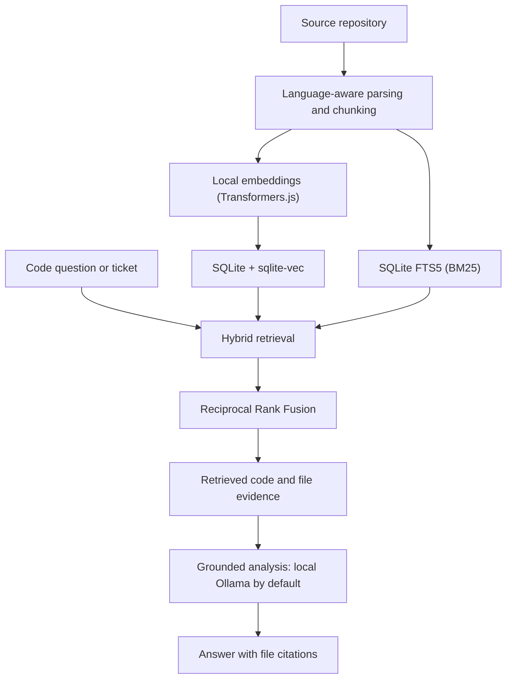

# Quarry

**Local-first codebase retrieval and grounded analysis.**

Quarry indexes a codebase locally, retrieves relevant source files and uses them as evidence for code questions and ticket analysis. It combines semantic and keyword search, then grounds answers in the retrieved code and cites the files used.

It is designed for engineers who want to explore and understand a codebase without sending source code to a hosted embedding service or requiring a separate database server.

Maintained by [Karl Doyle](https://github.com/KarlDoyle). Source: [github.com/KarlDoyle/quarry](https://github.com/KarlDoyle/quarry).

**Status:** Release-ready, as assessed by the maintainer. The source repository remains private. Evaluation caveats and provider data-handling details below are part of the release context.


## Architecture at a glance



The local-first default keeps indexing and retrieval on the developer's machine. An explicitly selected Anthropic provider or remote Ollama endpoint changes where retrieved context is sent; see [Technical design](#technical-design).

## How it works

1. **Index:** parse and chunk source files using language-aware handling.
2. **Embed:** generate local embeddings with Transformers.js.
3. **Store:** keep vectors, source text and full-text search data in Node's built-in SQLite.
4. **Retrieve:** combine dense vector search and BM25 keyword search using Reciprocal Rank Fusion.
5. **Analyse:** send retrieved context to a local LLM and produce an answer grounded in the source, with file citations.

The default analysis provider is local Ollama. Anthropic is available when selected explicitly, or as an explicitly enabled fallback. A configured Anthropic key alone never enables hosted inference.

## Why hybrid retrieval?

Semantic retrieval can find conceptually related code, while keyword retrieval can be useful for exact identifiers, symbols and error strings. Quarry combines both signals rather than relying on either alone.

The bundled evaluation is a small smoke test for the evaluation harness, not
evidence of representative retrieval quality. Use a corpus and gold set you
have permission to process before making performance claims.

### Evaluation

The checked-in three-query fixture uses `examples/sample-repo` and exists to
exercise the harness. Its results are not representative and should not be
quoted as product performance. The harness measures retrieval, not end-to-end
LLM response quality or latency.

See [the evaluation methodology](docs/EVAL-AND-PRECISION.md) and [the latest
Moss run](eval/RESULTS.md) for the current measurements and their limits.

Run the evaluation with:

```bash
pnpm eval
# Or supply a corpus and a matching JSON gold set:
pnpm eval /path/to/repository /path/to/goldset.json
```

## Ticket analysis

Quarry also exposes an `analyze-ticket` path that can ingest a Jira issue and analyse it against an indexed repository. It retrieves likely relevant code and asks the model to identify an approach, likely affected files and risks.

This capability became the foundation for **Marshal**, a separate MVP workflow that reuses Quarry's retrieval engine for multi-repository routing, CODEOWNERS-based ownership evidence and structured ticket refinement. Separating retrieval from ticket workflow lets each component evolve and be tested independently; Marshal is a technical spike, not a complete Jira product.

## Technical design

- **Runtime:** Node.js 24+, TypeScript.
- **Storage:** Node's built-in `node:sqlite`, `sqlite-vec` and SQLite FTS5.
- **Embeddings:** Transformers.js, running locally.
- **Retrieval:** dense vector search + BM25 keyword search, fused with Reciprocal Rank Fusion.
- **LLM:** local Ollama by default; optional Anthropic provider.
- **Interface:** CLI and importable library surface.

The [architecture note](docs/architecture.md) traces the indexing and answer path. [Retrieval design and evidence](docs/retrieval-design.md) describes the tests and the current limits of the evaluation artefacts.

No database server or native compiler is required for the native runtime path. The first index run downloads the embedding model from Hugging Face; subsequent indexing and retrieval can run locally. Local Ollama analysis sends prompts to the configured Ollama endpoint (localhost by default). Selecting Anthropic, or enabling hosted fallback, sends the query, ticket details, and retrieved source context to Anthropic. Setting `OLLAMA_HOST` to a remote server also sends that context to the configured server.

## Package installation

The package name is `@mrkarldoyle/quarry`. Install the CLI globally with:

```bash
npm install --global @mrkarldoyle/quarry
```

To use Quarry as a library in a project, install it as a dependency with `npm install @mrkarldoyle/quarry`.

## Quick start

```bash
pnpm install
pnpm build

node dist/cli.js index ./examples/sample-repo
node dist/cli.js search "retry a request with backoff"
node dist/cli.js analyze "how is the cart total calculated?"
node dist/cli.js analyze-ticket --fixture ./tests/fixtures/jira-issue.json
node dist/cli.js stats
```

For `analyze` and `analyze-ticket`, start Ollama and pull a model such as `llama3.1`:

```bash
ollama serve
ollama pull llama3.1
```

Hosted Anthropic use is explicit. Set `QUARRY_PROVIDER=anthropic` and
`ANTHROPIC_API_KEY` to select it, or also set `QUARRY_ANTHROPIC_FALLBACK=true`
to permit fallback if local Ollama fails.

The first indexing run downloads the embedding model once. The default local path does not require an API key.

## Engineering approach

The retrieval evaluation records both the cases where hybrid search helps and the cases where dense-only search performs better. AI assistants helped with implementation and test development. I chose the retrieval design, reviewed the results and decided which trade-offs to keep.

## Development and quality

```bash
pnpm check
pnpm lint
pnpm test
pnpm coverage
```

GitHub Actions runs typecheck, lint, coverage-enforced tests and a build. It also installs the packed tarball in a clean consumer and checks the library exports and CLI. See the [latest workflow run](https://github.com/KarlDoyle/quarry/actions).

## Roadmap

- ✅ Local index → hybrid search → grounded analysis in a local SQLite store.
- ✅ Jira ticket analysis and swappable embedding / LLM providers.
- ◻ Incremental per-file re-indexing.
- ◻ Richer symbol-level parsing.
- ◻ Cross-encoder reranking, if further evaluation shows it is worthwhile.

The project deliberately avoids native tree-sitter grammars, agentic multi-step loops and heavy evaluation frameworks in order to keep the core lean.

## Licence

Quarry is licensed under the MIT License. See [LICENSE](LICENSE).
