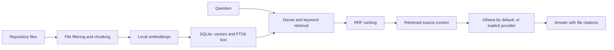

# Quarry architecture

Quarry has four stages: index a repository, retrieve relevant chunks, build a grounded prompt, and ask a configured language-model provider for an answer.

The indexer and chunking strategies are under `src/indexer/`. `VectorStore` in `src/vector-store/index.ts` persists chunk text, vector embeddings and full-text search data in the same local database. `AnalysisAgent` in `src/agent/` passes retrieved context to an `LLMProvider` and formats the response with citations.

## Local and hosted boundaries

Embedding generation runs locally. Ollama is the default answer provider and points to localhost unless configured otherwise. Selecting Anthropic or enabling hosted fallback sends the question and retrieved code context to that service. Setting an Ollama endpoint to another host also sends that context there. The local-first description therefore depends on the provider and endpoint configuration.

## Retrieval path

The default search combines vector nearest-neighbour results and SQLite FTS5 keyword results with Reciprocal Rank Fusion. The dense-only option exists for evaluation. It does not change the default search path.
